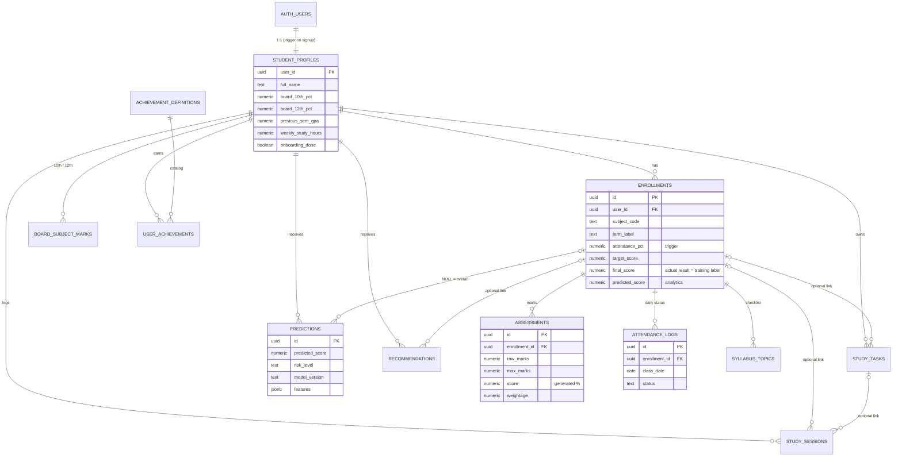

# Entity Relationship Diagram

## Who writes what

| Table / column | Student (JWT, RLS) | Backend (service_role) | Nightly job (service_role) | DB trigger |
|---|---|---|---|---|
| student_profiles | read, update own | - | - | created on signup |
| enrollments (except below) | full own | - | - | - |
| enrollments.attendance_pct | read | - | - | **writes** |
| enrollments.final_score | full own | - | - | - |
| enrollments.predicted_score, recommended_weekly_hours | read | **writes** (service_role) | - | - |
| assessments, attendance_logs, study_tasks, study_sessions, board_subject_marks, syllabus_topics | full own | - | - | - |
| study_tasks.completed_at | read | - | - | **writes** |
| user_achievements (catalog badges) | read | **awards** | - | - |
| user_achievements (custom, `definition_id` null) | full own | - | - | - |
| predictions | read | **writes** (service_role) | - | - |
| recommendations | read, mark `is_read` | **writes** (service_role) | - | - |
| achievement_definitions, education_boards | read | admin only | - | - |
